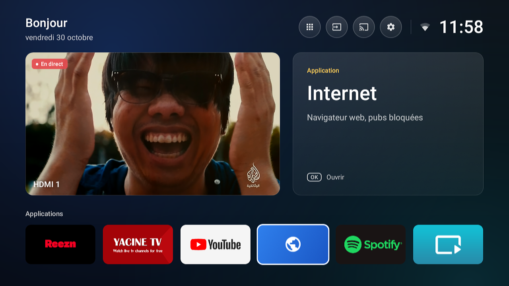

# cvte-tv-home

Make a cheap Chinese **CVTE / MediaTek Android 9 TV** fast and calm again: remove the junk, fix
apps that crash for lack of memory, stop the stutter in 1080p video, and (if you want) replace the
stock launcher with a light home screen whose background glows with the colours of the live HDMI picture.

Tested on two real TVs with **512MB of RAM**, and written for that budget:

| Board | Storage | Stock launcher | Used |
|---|---|---|---|
| mt5862_512m, TP.SK518D.PB806 | 4GB | `com.cvte.tv.launcher.saturn` | everything, with the Accueil home screen |
| mt5862_512m | 8GB | `com.cvte.tv.launcher.space` | its own launcher, with the Optimiseur TV helper |



## Is it my TV?

Probably, if:

- Settings → About shows model **SMART_TV**, Android **9**, and very little memory (512MB–1GB).
- The settings app is CVTE's own (blue tiles, no "Developer options"), and the launcher is
  `LauncherSaturn` or `LauncherSpace`.
- The factory menu (below) shows a board like **TP.SK518D.PB806** and an upgrade file like `allupgrade518_4GB_512MB_*.bin`.

These boards are sold under many brands, including fake ones ("SMASNUG").

## What it does

| | |
|---|---|
| **Removes the junk** | Ads, shop demo, four screen-sharing apps, weather, an old browser. Listed in [`lists/`](lists). Restorable. |
| **Fixes crashing apps** | Raises the per-app memory limit from 48MB to 96MB. IPTV apps that load a big channel list stop crashing (we saw the same `OutOfMemoryError` on both TVs). |
| **Smoother video** | Switches off the factory script that empties the file cache every 10 seconds, which made 1080p YouTube stutter. |
| **Steadier Wi-Fi** | Keeps Wi-Fi power save off: a TV is always plugged in, and power save adds delay and drops on a weak signal. |
| **Instant app switching** | Window animations off, the rest at half speed. |
| **New home screen** | Live HDMI 1 preview with true rounded corners, a glass card naming what's selected, up to 6 pinned apps (hold OK to move, replace or remove; + adds one), shortcuts for apps, sources, casting and settings, Wi-Fi signal and clock. The browser (Chrome or TV Bro) shows as a plain blue "Internet" tile. |
| **Ad blocking in Chrome only** | About 65 ad and pop-up networks become unreachable for Chrome, while IPTV apps keep the normal DNS (system-wide blockers break some of them). Hold OK on Chrome's tile to switch it off for sites that refuse ad blockers. |
| **Live ambient light** | Like YouTube's ambient mode: the background takes the colours of the HDMI picture, sampled every few seconds. Apps get their own colours. |

The home screen is plain Java with no libraries and no Gradle: about 19MB of RAM, 8ms median frame time
while moving around.

**Keeping your own launcher?** The smoother video and steadier Wi-Fi come from the home screen's
background fixes. The **Optimiseur TV** helper (`tweaks/`, 17KB, no icon, nothing on screen) applies
just those, and changes nothing else.

## Before you start

> [!WARNING]
> At your own risk. This removes system apps and changes a system setting. It worked on our TV and
> `undo.sh` reverses it, but firmware differs between units. Keep the TV powered during the steps.

> [!WARNING]
> **Network ADB on these TVs has no password and gives root.** While it's on, any device on your Wi-Fi
> can control the TV. The live ambient light, the cache-flusher fix and the Wi-Fi power-save fix need
> it on; everything else keeps working if you turn it off afterwards (the glow then uses app colours).

## 1. Turn on ADB (factory menu)

There are no Developer options on this firmware. ADB is in the hidden factory menu:

1. With the remote, press **MENU**, then **1 1 4 7** quickly. (On some units: Picture → Contrast, then **9 7 3 5**.)
2. Go to **DEBUG** → **ADB ENABLE** → **ON**. Touch nothing else here: panel, HDCP and Widevine
   settings in this menu can't be undone.
3. Unplug the TV for 10 seconds and plug it back in.
4. Find the TV's IP in your router. Its Wi-Fi address changes on every start, so the IP can change too.

## 2. Install

You need `adb`, a JDK (17 or newer) and the Android SDK (any platform and build-tools). On Windows,
run the scripts from Git Bash.

```sh
export ANDROID_HOME=/path/to/android-sdk
sh install.sh 192.168.1.50
```

It asks before each step, keeps a copy of every removed app in `backup/`, and records what it changed
in `state-<ip>.txt`. Put your own apps in [`launcher/res/values/apps.xml`](launcher/res/values/apps.xml)
first: which ones are pinned and the glow colours for each.

If you take the home screen, press Home on the TV once at the end. If Android asks which app to use,
pick **Accueil**, then **Always**. If you say no to it, the script offers the Optimiseur TV helper instead.

Then unplug the TV for 10 seconds (the memory limit applies at start; `adb reboot` leaves these TVs in
standby).

## Undo

```sh
sh undo.sh 192.168.1.50
```

Puts back the removed apps, the stock launcher (or removes the helper), animations and the memory limit.

How the code is organised and why: [`docs/ARCHITECTURE.md`](docs/ARCHITECTURE.md). Versions:
[`CHANGELOG.md`](CHANGELOG.md).

## What we learned about this firmware

Useful if you want to build on it:

- **`pm disable-user` doesn't stick.** The firmware turns disabled apps back on when Android restarts.
  `pm uninstall -k --user 0` does stick, and `cmd package install-existing` reverses it.
- **The stock launcher is forced by name.** At boot, and from the Home key, the firmware starts
  `com.cvte.tv.launcher.saturn` with an extra `android.intent.category.COMMON_HOME`, so a new launcher
  must declare that category. It also never delivers `BOOT_COMPLETED` to added apps. An accessibility
  service that watches only that launcher's package reopens ours (`HomeGuard`). Accessibility services
  are started at boot and kept alive, which is also how the helper runs.
- **Android drops an accessibility service while its app is updated.** The home screen turns its guard
  back on itself, using `WRITE_SECURE_SETTINGS` granted once over adb.
- **The Home key inside the launcher means "go to TV"** (`ro.CVT_EN_HOME_KEY_ENTER_TV=1`), so full-screen
  HDMI opens in the firmware's own player (`com.cvte.tv.setting/.TvSettingActivity`), not inside our app.
- **The MENU key is taken** by the firmware's TV menu, so app options open with a long press on OK.
- **A factory script flushes the cache.** `/vendor/bin/drop_caches.sh` (service `drop_caches` in
  `/vendor/etc/init/init.fusion.rc`) runs `echo 2 > /proc/sys/vm/drop_caches` every 10 seconds whenever
  free memory is under 100MB, which on 512MB is almost always. Apps then keep re-reading their code from
  storage, and 1080p video stutters. `setprop ctl.stop drop_caches` works from the ADB shell (no root);
  the home screen runs it at start, since the firmware restarts the script on every boot.
- **Wi-Fi power save comes back after every reconnect.** Android switches it on after each DHCP, and
  `iw dev wlan0 set power_save off` needs root. The home screen asks the TV's adbd for `root:` once per
  boot (it changes nothing on ADB's exposure: anyone who can reach it could do the same), then switches
  power save off at start, 5 seconds after each Wi-Fi reconnect, and every 5 minutes.
- **HDMI video is a hardware layer.** MediaProjection and `screenrecord` see it as black, and views can't
  clip it. `screencap` does see it; it prints a log line first and uses a 16-byte header. The ambient
  light reads ~150 pixels of the preview from `exec:nice -n 19 screencap` over the TV's own ADB, and the
  rounded corners are painted over the video with an exact copy of what's behind them.
- **Netflix:** these TVs have no Google Play, aren't Play Protect certified and have no Widevine keys,
  so current Netflix apps refuse to run. A certified streaming stick is the only fix.
- **Chrome takes switches from a file.** The firmware is a debug build (`ro.debuggable=1`), so Chrome reads
  `/data/local/chrome-command-line` when it starts, and that folder is writable by any app. The home screen
  writes a `--host-resolver-rules` blocklist there (see [`adblock.xml`](launcher/res/values/adblock.xml)).
  Android's Private DNS isn't an alternative here: it applies to every app, and DNS-over-TLS failed on our
  mobile 5G line, cutting all lookups.
- HDMI 1 is `com.mediatek.tvinput/.hdmi.HDMIInputService/HW4`.

## Ideas

- Previews for every HDMI input and AV, with rename.
- Interface languages other than French.
- A wallpaper choice and a reduced-motion switch.
- Lists for other CVTE boards: open a PR with yours.

## Credits

Ideas and techniques from [tv-detox](https://github.com/Ansub/tv-detox) (draw the background once,
focus lift) and [cleanyourtv](https://github.com/Gathin23/cleanyourtv) (tinted glow mask, the Home
watcher). No code was copied. [TV Bro](https://github.com/truefedex/tv-bro) is a good ad-blocking
browser for these TVs.

## Licence

MIT, see [LICENSE](LICENSE). This project is not affiliated with CVTE, MediaTek or any TV brand.
